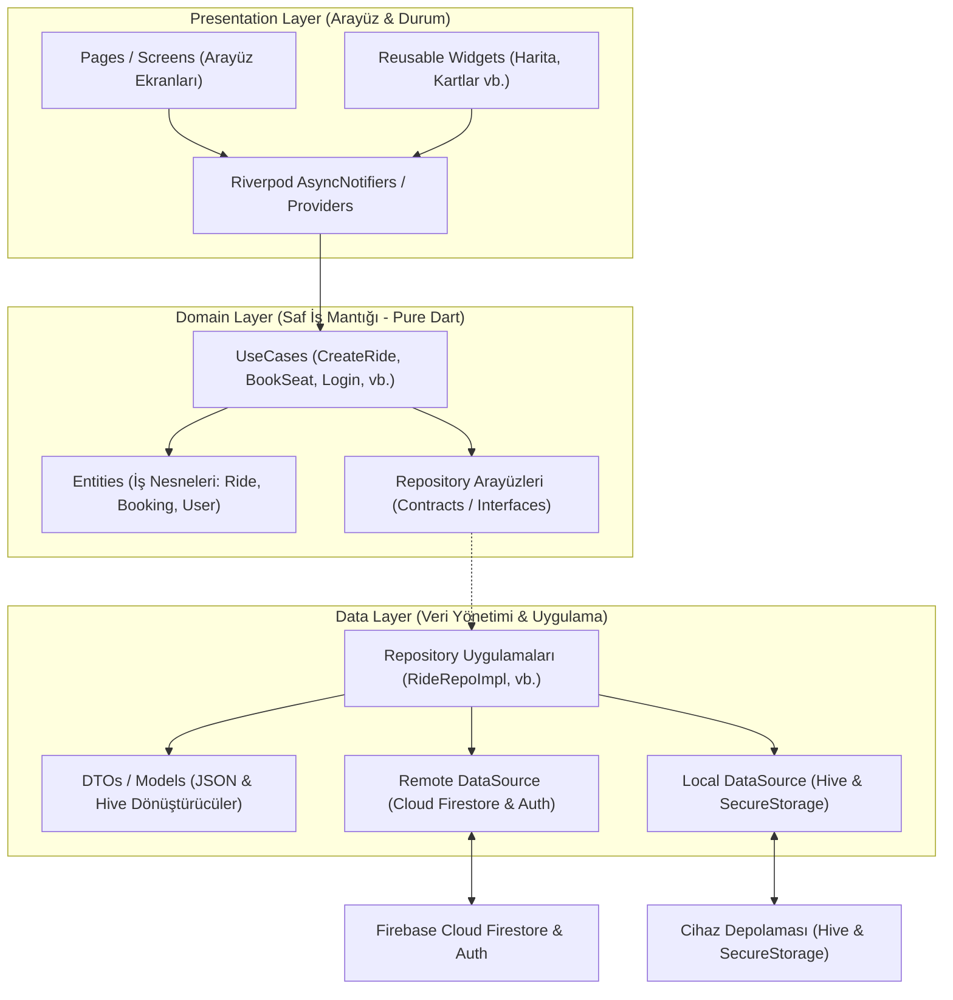
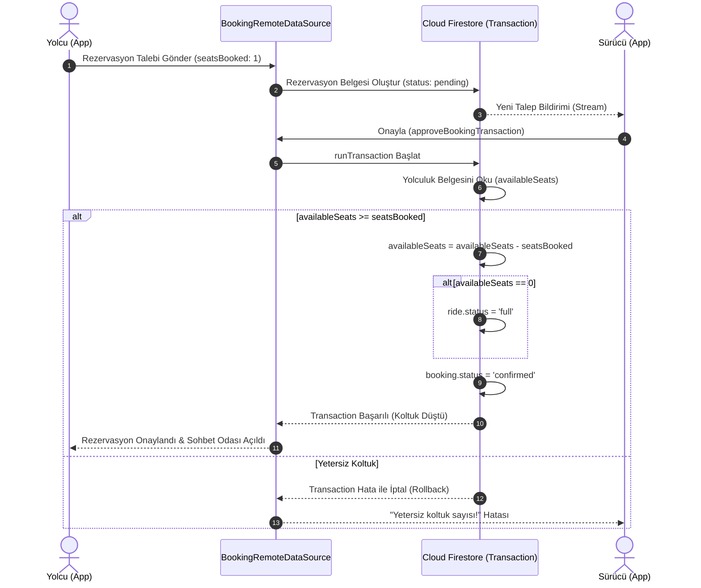

# Paylaşımlı Yolculuk (Carpooling / Ridesharing) Mobil Uygulaması
## Kapsamlı Proje Tanıtım, Amaç, Mimari ve Teknoloji Dokümantasyonu

---

## 1. Proje Nedir? (Genel Bakış)

**Paylaşımlı Yolculuk (Carpooling / Ridesharing)**, aynı yöne seyahat eden sürücüler ile yolcuları güvenli, ekonomik ve sürdürülebilir bir ekosistemde bir araya getiren modern bir mobil platformdur. 

Özellikle üniversite kampüsleri, banliyö hatları, iş merkezleri ve şehirlerarası güzergahlarda düzenli seyahat eden bireyler için tasarlanan uygulama; sürücülerin araçlarındaki boş koltukları ilana çıkarmalarını, yolcuların ise bu koltukları arayıp rezerve ederek yol masraflarını ortaklaşa paylaşmalarını sağlar.

Uygulama; harita üzerinde canlı güzergah çizimi, açık kaynaklı harita desteği (OpenStreetMap), anlık mesajlaşma, çift rezervasyonu engelleyen atomik işlem güvenliği, güvenli yerel oturum saklama ve internet bağlantısı koptuğunda dahi çalışmayı sürdüren **Offline-First (Çevrimdışı Öncelikli)** mimarisi ile donatılmıştır.

---

## 2. Projenin Amacı ve Hedefleri

### 2.1. Çözülen Temel Problemler
1. **Yüksek Yakıt ve Seyahat Maliyetleri:** Bireysel araç kullanımının getirdiği yakıt, otopark ve geçiş ücreti maliyetlerinin tek bir kişiye yüklenmesi.
2. **Trafik Sıkışıklığı ve Park Sorunu:** Yollarda tek yolculu araç sayısının çokluğu nedeniyle şehir içi ve kampüs girişlerinde yaşanan yoğunluk.
3. **Karbon Ayak İzi ve Çevre Kirliliği:** Fosil yakıtlı araçların oluşturduğu hava kirliliği ve karbon emisyonu.
4. **Güven Problemi:** Tanınmayan kişilerle yolculuk yapma endişesi ve doğrulama mekanizmalarının eksikliği.
5. **Kesintili Ağ Koşulları:** Seyahat esnasında tünellerde, otoyollarda veya zayıf çekim alanlarında mobil uygulamaların kilitlenmesi veya bilet/yolculuk bilgilerine erişilememesi.

### 2.2. Temel Hedefler
- **Ekonomik Tasarruf:** Boş koltukların paylaştırılmasıyla hem sürücü hem de yolcu için seyahat maliyetlerini %50 ila %75 oranında düşürmek.
- **Çevresel Sürdürülebilirlik:** Trafikteki aktif araç sayısını azaltarak karbon salınımını ve çevre kirliliğini minimuma indirmek.
- **Güvenli ve Şeffaf Topluluk:** Karşılıklı 1-5 yıldızlı değerlendirme ve yorum sistemi, profil doğrulama ve tercihler (sigara, evcil hayvan, müzik) ile güvenilir bir seyahat ortamı tesis etmek.
- **Kesintisiz Kullanıcı Deneyimi:** Hibrit veri mimarisi sayesinde internet bağlantısı olmadığında dahi önceden görüntülenen yolculuklara, bilet detaylarına ve geçmiş mesajlara anında erişim sunmak.
- **Maliyetsiz ve Açık Kaynaklı Altyapı:** Lisans ve harita kota maliyetlerini sıfırlamak için OpenStreetMap ve Nominatim servislerinden yararlanmak.

---

## 3. Sistem Mimarisi

Uygulama, kurumsal yazılım standartlarına, yüksek test edilebilirliğe ve modüler bakım kolaylığına uygun olarak **Feature-First Clean Architecture (Özellik Odaklı Temiz Mimari)** ve **Riverpod** reaktif durum yönetimi prensipleriyle inşa edilmiştir.



### 3.1. Katmanların Görev ve Sorumlulukları

#### A. Domain Katmanı (Saf İş Mantığı - Pure Dart)
- Dış kütüphanelerden, Flutter UI çatısından ve veritabanı sürücülerinden tamamen bağımsızdır.
- **Entities:** Sistemdeki temel varlıkları temsil eden değişmez (immutable) veri modelleridir (`UserEntity`, `RideEntity`, `BookingEntity`, `VehicleEntity`, `MessageEntity`, `ReviewEntity`).
- **UseCases:** Tek bir iş kuralını yürüten sınıflardır (örn: `BookSeatUseCase`, `SearchRidesUseCase`, `CreateRideUseCase`).
- **Repository Interfaces:** Data katmanının uyması gereken soyut sözleşmeleri (`IRideRepository`, `IBookingRepository`, `IAuthRepository`) tanımlar.

#### B. Data Katmanı (Veri Kaynakları ve Depolama)
- Verilerin uzak sunucudan (Cloud Firestore) çekilmesi, dönüştürülmesi ve yerel önbelleğe (Hive / SecureStorage) yazılmasından sorumludur.
- **Models / DTOs:** Entity sınıflarını genişletir, JSON serileştirme (`toJson`, `fromJson`) ve yerel veritabanı haritalama işlemlerini gerçekleştirir.
- **Remote Data Sources:** Firebase Authentication ve Cloud Firestore CRUD/Stream işlemlerini yürütür.
- **Local Data Sources:** Cihaz içi hızlı NoSQL önbellek (`Hive`) ve güvenli şifrelenmiş anahtar saklama (`FlutterSecureStorage`) işlemlerini yönetir.
- **Repository Implementations:** İnternet durumuna göre strateji belirler; bağlantı varsa veriyi buluttan çeker ve yerel önbelleği tazeler, bağlantı yoksa doğrudan yerelden sunar (**Network-First with Local-Fallback**).

#### C. Presentation Katmanı (Arayüz ve Reaktif Durum)
- Kullanıcı etkileşimlerini dinler ve arayüzü çizdirir.
- **Screens & Widgets:** Material 3 standartlarında, duyarlı (responsive) sayfa ve bileşenlerdir.
- **Riverpod Notifiers (`AsyncNotifier` / `Notifier`):** Domain katmanındaki UseCase'leri tetikler, asenkron işlem durumlarını (`AsyncLoading`, `AsyncData`, `AsyncError`) yönetir ve UI katmanına reaktif olarak besler.

---

### 3.2. Hibrit ve Çevrimdışı Öncelikli (Offline-First) Depolama Mimarisi

Uygulama, verinin türüne ve hassasiyetine göre **4 kademeli bir depolama stratejisi** yürütür:

| Depolama Türü | Teknoloji / Kütüphane | Barındırılan Veri | Çalışma ve Eşitleme Mantığı |
| :--- | :--- | :--- | :--- |
| **1. Güvenli Depolama** | `flutter_secure_storage` | JWT Token, Refresh Token, Aktif Kullanıcı ID | AES/Keychain ile şifreli; oturum açılışında yazılır, çıkışta temizlenir. |
| **2. Sistem Tercihleri** | `shared_preferences` | Tema modu (Karanlık/Aydınlık), Dil, Çevrimdışı Simülasyon Durumu | Hızlı anahtar-değer depolaması; uygulama açılışında senkron okunur. |
| **3. Yapılandırılmış NoSQL Cache** | `hive` & `hive_flutter` | Yolculuk ilanları (`box_my_rides`), Rezervasyonlar (`box_bookings`), Sohbetler (`box_chats`), Araçlar (`box_vehicles`) | **Network-First with Fallback:** İnternet varken buluttan çekilip kutulara (`Box`) yazılır; internet koptuğunda UI kesintisiz olarak kutulardan beslenir. |
| **4. Bulut Veritabanı** | `cloud_firestore` | Global yolculuk havuzu, anlık mesajlaşma akışları, kullanıcı profilleri, puanlar | Gerçek zamanlı `Stream` abonelikleri ve atomik `Transaction` işlemleri. |

---

### 3.3. Atomik Koltuk Rezervasyonu ve Eşzamanlılık (Concurrency)

Son kalan koltuğa aynı anda başvuran iki yolcunun oluşturabileceği çifte rezervasyon (overbooking) problemini önlemek için veritabanı seviyesinde atomik işlem yapısı (`runTransaction`) uygulanmıştır:



---

## 4. Kullanılan Teknolojiler ve Kütüphaneler

Projede kullanılan tüm teknolojiler ve üstlendikleri sorumluluklar aşağıda kategorize edilmiştir:

### 4.1. Çekirdek Çatı ve Dil
- **Dart 3.x:** Null-safety (boş değer güvenliği), pattern matching ve güçlü tip kontrolü sunan modern programlama dili.
- **Flutter 3.x:** iOS, Android ve Web için tek kod tabanından (Cross-Platform) 60 FPS performans sağlayan UI motoru.

### 4.2. Durum Yönetimi ve Mimari
- **flutter_riverpod (v2.6.1):** Derleme anında tip güvenliği sunan, BuildContext bağımlılığı olmayan, `AsyncNotifier` desteğiyle asenkron veri yönetimini kolaylaştıran modern durum yönetim aracı.
- **riverpod_annotation (v2.6.1):** Kod üretim desteği ile standartlaştırılmış sağlayıcı (Provider) tanımlama aracı.

### 4.3. Yönlendirme (Routing) ve Güvenlik Duvarı
- **go_router (v14.6.2):** Bildirimsel (declarative) rota yönetimi, derin link (deep link) altyapısı ve `authNotifierProvider` durumuna bağlı olarak korumalı sayfaları denetleyen `redirect` (Auth Guard) sistemi.

### 4.4. Bulut ve Arka Plan Servisleri (BaaS)
- **Firebase Core (v3.8.1):** Firebase altyapısının başlatılması ve platform yapılandırması.
- **Firebase Auth (v5.3.4):** Kullanıcı oturum açma, kayıt olma, parola doğrulama ve oturum dinleme servisleri.
- **Cloud Firestore (v5.5.1):** NoSQL bulut veritabanı; anlık gerçek zamanlı veri akışları (`Stream`), sorgulamalar ve atomik işlemler (`Transaction`).

### 4.5. Yerel Depolama ve Önbellek (Offline-First)
- **Hive & Hive Flutter (v2.2.3 & v1.1.0):** Saf Dart ile yazılmış, SQLite'a göre katbekat hızlı çalışan anahtar-değer tabanlı hafif NoSQL veritabanı.
- **Flutter Secure Storage (v9.2.2):** Android üzerinde Keystore, iOS üzerinde Keychain kullanarak JWT ve oturum verilerini AES şifreleme ile saklayan güvenlik paketi.
- **Shared Preferences (v2.3.3):** Tema modu ve basit kullanıcı ayarlarını platform düzeyinde saklayan kütüphane.

### 4.6. Harita, Coğrafi Konum ve Rota Çizimi
- **flutter_map (v7.0.2):** OpenStreetMap (OSM) karo katmanlarını (tile layers) GPU hızlandırmalı olarak render eden açık kaynak harita motoru.
- **latlong2 (v0.9.1):** Enlem/boylam koordinat matematiği ve mesafe hesaplamaları.
- **geolocator (v13.0.2):** Cihazın anlık GPS konumunu hassas şekilde tespit etme ve konum izinleri yönetimi.
- **Nominatim OpenStreetMap Geocoding API:** Koordinattan adrese (reverse geocoding) ve adresten koordinata ücretsiz arama sağlayan REST servisi (`http` kütüphanesi ile entegre).

### 4.7. Tasarım ve Kullanıcı Arayüzü
- **Material 3:** Modern Android ve iOS arayüz kılavuzlarına tam uyumlu renk paleti ve yuvarlatılmış kart tasarımı.
- **Google Fonts (v6.2.1):** Tipografi kalitesini artıran `Plus Jakarta Sans` / `Roboto` yazı tipi entegrasyonu.
- **Cupertino Icons (v1.0.8):** iOS tarzı piktogram ve ikon desteği.

---

## 5. Uygulama Modülleri ve Fonksiyonel Özellikler

Uygulama `lib/features/` dizini altında 5 temel iş modülüne ayrılmıştır:

```
lib/
├── core/                       # Uygulama geneli ortak yapılar
│   ├── constants/              # Renkler, saklama anahtarları vb.
│   ├── errors/                 # Exception ve Failure tanımları
│   ├── router/                 # GoRouter ve AuthGuard yönlendirme
│   ├── services/               # Bağlantı ve Seeder servisleri
│   ├── storage/                # Hive, SecureStorage ve Mock veri motoru
│   ├── theme/                  # Açık / Koyu Material 3 tema yapılandırması
│   └── utils/                  # Tarih formatlayıcılar, Geocoding ve Validator'lar
└── features/
    ├── auth/                   # Kimlik Doğrulama (Giriş, Kayıt, Oturum Kontrolü)
    ├── rides/                  # Yolculuk İlanı Açma, Filtreleme, Haritada Gösterme
    ├── bookings/               # Koltuk Rezervasyonu, Onaylama/Reddetme, Biletlerim
    ├── chat/                   # 1-e-1 Gerçek Zamanlı Mesajlaşma & Konum Paylaşımı
    └── profile/                # Profil Bilgileri, Araç Ekleme/Listeleme, Puanlama
```

### 5.1. Kimlik Doğrulama (`auth`)
- E-posta ve parola ile kayıt olma ve giriş yapma.
- Hızlı test ve jüri değerlendirmesi için tek tıkla **Hazır Demo Kullanıcıları** (Sürücü Ahmet, Yolcu Zeynep, Yolcu Mehmet) ile giriş yapabilme.
- Oturum durumunun `FlutterSecureStorage` üzerinden otomatik hatırlanması ve token yenileme desteği.

### 5.2. Yolculuk Keşfi ve Harita (`rides`)
- Başlangıç noktası, varış noktası, seyahat tarihi ve boş koltuk sayısına göre ilan arama.
- OpenStreetMap tabanlı `RouteMapWidget` ile başlangıç noktası yeşil pin, ara duraklar turuncu pin ve varış noktası kırmızı pin ile gösterilir; aradaki güzergah dinamik polyline çizgisi ile haritaya oturtulur.
- Harita üzerinden doğrudan koordinat seçme veya Nominatim üzerinden metinle adres arama.

### 5.3. Yolculuk İlanı Yayınlama (`rides`)
- Sürücülerin araçlarını seçerek kalkış saati, tahmini varış saati, güzergah ara durakları, koltuk başına ücret ve boş kontenjan bilgilerini belirleyip saniyeler içinde ilan yayınlayabilmesi.

### 5.4. Koltuk Rezervasyonu ve Bilet Yönetimi (`bookings`)
- Yolcuların istedikleri sayıda koltuk seçerek rezervasyon oluşturabilmesi.
- Sürücünün bekleyen talepleri kabul veya reddetmesi; kabul anında Firestore transaction ile koltuk sayısının atomik olarak düşürülmesi.
- **Yolculuklarım Ekranı:** "Yolcu Olarak" ve "Sürücü Olarak" sekmelerinde aktif, tamamlanmış ve iptal edilmiş rezervasyonların kartlar halinde listelenmesi.

### 5.5. Gerçek Zamanlı Sohbet Odası (`chat`)
- Rezervasyonu onaylanan yolcu ve sürücü arasında otomatik sohbet odasının başlatılması.
- Anlık mesajlaşma (`StreamProvider` tabanlı gerçek zamanlı Firestore senkronizasyonu).
- Buluşma noktasının kolay bulunması için sohbet içerisinden tek tuşla GPS konumu paylaşabilme.

### 5.6. Profil, Araç Yönetimi ve Değerlendirme (`profile`)
- Sürücülerin araç marka, model, plaka, renk ve kapasite bilgilerini kaydedebilmesi.
- Yolculuk tamamlandığında sürücü ve yolcunun birbirine 1-5 yıldız aralığında puan ve metin yorumu bırakabilmesi.
- Verilen puanların kullanıcının genel puan ortalamasını (`ratingAvg`) ve yorum sayısını (`ratingCount`) anlık güncellemesi.
- **Çevrimdışı (Uçak Modu) Simülatörü:** Profil ekranında bulunan anahtar ile anında internet kesintisi simüle edilebilir; uygulamanın Hive yerel kutularından nasıl çalıştığı canlı olarak gözlemlenebilir.

---

## 6. Kurulum ve Çalıştırma Adımları

Projeyi yerel geliştirme ortamında çalıştırmak için aşağıdaki adımları sırasıyla uygulayabilirsiniz:

### 6.1. Gereksinimler
- Flutter SDK (>= 3.13.5)
- Dart SDK (>= 3.13.5)
- Android Studio / VS Code (Flutter eklentileri kurulu)
- İnternet bağlantısı (İlk paket indirmeleri ve harita karoları için)

### 6.2. Terminal Komutları

```bash
# 1. Proje dizinine geçiş yapın
cd paylasimli_yolculuk

# 2. Gerekli bağımlılıkları yükleyin
flutter pub get

# 3. Statik kod analizini çalıştırın (0 hata / 0 uyarı garantisi)
flutter analyze

# 4. Birim ve widget testlerini yürütün
flutter test

# 5. Uygulamayı bağlı bir cihazda veya emülatörde başlatın
flutter run
```

---

## 7. Özet Değerlendirme

Bu proje; akademik standartlara ve modern yazılım mühendisliği ilkelerine tam uyumlu, **Clean Architecture** katman ayrımını katı kurallarla koruyan, **Riverpod** ile reaktif ve hatasız durum yönetimi sağlayan, açık kaynak teknolojilerle maliyeti optimize edilmiş ve **Offline-First** mimarisiyle saha şartlarında kesintisiz çalışan eksiksiz bir bitirme çalışmasıdır.

